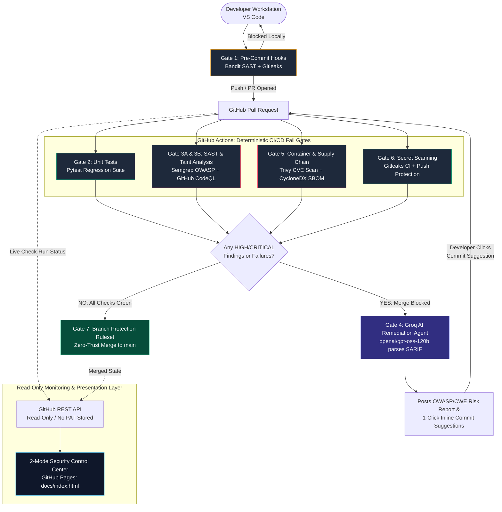

# AI-Driven DevSecOps Pipeline & Security Control Center

[](https://iandarwisy.github.io/ai-devsecops-pipeline/)
[](https://groq.com/)
[](#7-gate-security-architecture)
[](#verification-evidence-live-pull-requests)

An end-to-end **Shift-Left, Zero-Trust DevSecOps pipeline** integrated with an automated **Groq AI Remediation Agent** (`openai/gpt-oss-120b`) and a **2-Mode Security Control Center Dashboard**. Designed as a Final Year Project (FYP) at the Kulliyyah of Information and Communication Technology (KICT), IIUM, this system enforces deterministic security gating from the developer's local workstation to production merges while reducing Mean Time to Remediate (MTTR) through 1-click inline pull request patches.

🔗 **Live Security Control Center:** [https://iandarwisy.github.io/ai-devsecops-pipeline/](https://iandarwisy.github.io/ai-devsecops-pipeline/)

---

## System Architecture & Workflow

The pipeline separates **local shift-left ergonomics**, **deterministic CI/CD fail gates**, **AI-assisted remediation**, and **zero-trust repository governance**:



---

## 7-Gate Security Architecture

| Gate        | Stage                    | Tooling / Engine                 | Enforcement Role                                                                                                                  |
| :---------- | :----------------------- | :------------------------------- | :-------------------------------------------------------------------------------------------------------------------------------- |
| **Gate 01** | Pre-Commit (Local)       | **Bandit + Gitleaks**            | Blocks insecure Python patterns and hardcoded secrets on the developer workstation before push.                                   |
| **Gate 02** | Unit Testing             | **Pytest CI**                    | Validates Flask application functionality and `/health` endpoint stability after every commit.                                    |
| **Gate 03** | SAST & Deep Scan         | **Semgrep (3A) + CodeQL (3B)**   | Enforces OWASP Top 10 rules and semantic data-flow taint tracking; uploads SARIF to GitHub Code Scanning.                         |
| **Gate 04** | AI Remediation           | **Groq (`openai/gpt-oss-120b`)** | Parses Semgrep SARIF via `scripts/ai_remediator.py`, generates plain-English risk summaries, and submits 1-click inline PR fixes. |
| **Gate 05** | Container & Supply Chain | **Trivy + CycloneDX SBOM**       | Builds hardened non-root Docker images (`python:3.12-slim`), exports `sbom.cdx.json`, and blocks merges on any HIGH/CRITICAL CVE. |
| **Gate 06** | Secrets Gate             | **Gitleaks CI**                  | Audits full pull request commit history to catch bypassed local hooks or leaked credentials.                                      |
| **Gate 07** | Governance & Merge       | **Branch Protection Ruleset**    | Locks `main` against direct pushes and deterministically blocks merges until all required CI checks pass.                         |

---

## Verification Evidence (Live Pull Requests)

Two dedicated Pull Requests serve as live, auditable proof of the pipeline's enforcement and remediation lifecycle:

| Test Case                                 | Pull Request                                                              | Target Scope                                                                                  | Pipeline Outcome             | Key Proof                                                                                                                                        |
| :---------------------------------------- | :------------------------------------------------------------------------ | :-------------------------------------------------------------------------------------------- | :--------------------------- | :----------------------------------------------------------------------------------------------------------------------------------------------- |
| **Case 1: Blocked PR (Before)**           | [**PR #9**](https://github.com/iandarwisy/ai-devsecops-pipeline/pull/9)   | `app/vulnerable_routes.py` (SQLi, Command Injection, Path Traversal, MD5) & legacy base image | **Blocked (`3 / 7` Passed)** | Gate 3A (Semgrep), Gate 3B (CodeQL), and Gate 5 (Trivy) block merge; Gate 4 (Groq) posts full OWASP/CWE report & inline patches.                 |
| **Case 2: Remediated & Hardened (After)** | [**PR #10**](https://github.com/iandarwisy/ai-devsecops-pipeline/pull/10) | `app/audit_helper.py` (CWE-327 MD5), `Dockerfile`, `app/requirements.txt`                     | **Merged (`7 / 7` Passed)**  | 1-click Groq commit suggestion patched `hashlib.md5` → `hashlib.sha256`; container hardened to `python:3.12-slim` with **0 HIGH/CRITICAL CVEs**. |

---

## 2-Mode Security Control Center

Hosted statically via GitHub Pages (`docs/index.html`) using Tailwind CSS and Chart.js:

- **Interactive Demo Mode:** Allows evaluators and showcase visitors to inspect all 7 security gates, click **Accept & Apply AI Fix**, observe real-time KPI/Chart.js transitions from `MERGE BLOCKED` to `READY TO MERGE`, and hit **Reset Demo** at any time.
- **Live GitHub Sync Mode (Zero-Trust Read-Only):** Queries the public GitHub REST API (`pulls` and `check-runs` endpoints) to render live gate telemetry for **PR #9** and **PR #10**. In accordance with zero-trust principles, no Personal Access Tokens (PATs) are stored client-side; all write operations remain strictly authenticated inside GitHub.

---

## Repository Structure

```text
ai-devsecops-pipeline/
├── .github/workflows/       # 7-Gate GitHub Actions CI/CD & CodeQL workflows
├── app/                     # Target Flask application, audit_helper.py, Pytest suite & requirements
├── docs/                    # Static 2-Mode Control Center (index.html) for GitHub Pages & evidence assets
├── scripts/
│   └── ai_remediator.py     # Groq LLM SARIF parser & GitHub PR inline review bot
├── .pre-commit-config.yaml  # Local Gate 1 hook definitions (Bandit, Gitleaks, hygiene checks)
├── Dockerfile               # Hardened non-root python:3.12-slim image (0 HIGH/CRITICAL CVEs)
└── README.md                # Project documentation & architecture overview
```

---

## Local Quick Start

1. **Clone the repository and set up the virtual environment:**

   ```bash
   git clone [https://github.com/iandarwisy/ai-devsecops-pipeline.git](https://github.com/iandarwisy/ai-devsecops-pipeline.git)
   cd ai-devsecops-pipeline
   python -m venv .venv
   # Windows PowerShell: .venv\Scripts\Activate.ps1
   # Linux/macOS: source .venv/bin/activate
   pip install -r app/requirements.txt pre-commit
   ```

2. **Install Gate 1 local shift-left hooks:**

   ```bash
   pre-commit install
   ```

3. **Run local tests or preview the Security Control Center:**
   ```bash
   pytest app/
   python -m http.server 8000 --directory docs
   ```
   Open `http://localhost:8000/` in your browser (or visit the live deployment at [https://iandarwisy.github.io/ai-devsecops-pipeline/](https://iandarwisy.github.io/ai-devsecops-pipeline/)).

---

## Author

**Ian Darwisy bin Zuraihan**
Bachelor of Computer Science (Honours) — Security in Digital Systems
Kulliyyah of Information and Communication Technology (KICT), International Islamic University Malaysia (IIUM)
